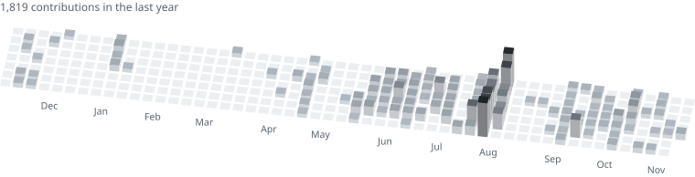
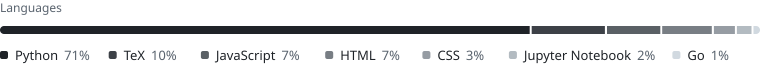

# Jake Rothstein

CS @ [Georgia Tech](https://www.cc.gatech.edu/) · prev SWE Intern @ GitHub

<picture>
  <source media="(prefers-color-scheme: dark)" srcset="assets/skyline-dark.svg">
  <source media="(prefers-color-scheme: light)" srcset="assets/skyline-light.svg">
  
</picture>

<picture>
  <source media="(prefers-color-scheme: dark)" srcset="assets/languages-dark.svg">
  <source media="(prefers-color-scheme: light)" srcset="assets/languages-light.svg">
  
</picture>

[Repositories](https://github.com/jakerothstein?tab=repositories) · [Resume](https://github.com/jakerothstein/resume_repo)

<!-- The skyline and languages chart are generated by scripts/build_cards.py and refreshed daily by .github/workflows/metrics.yml. -->
